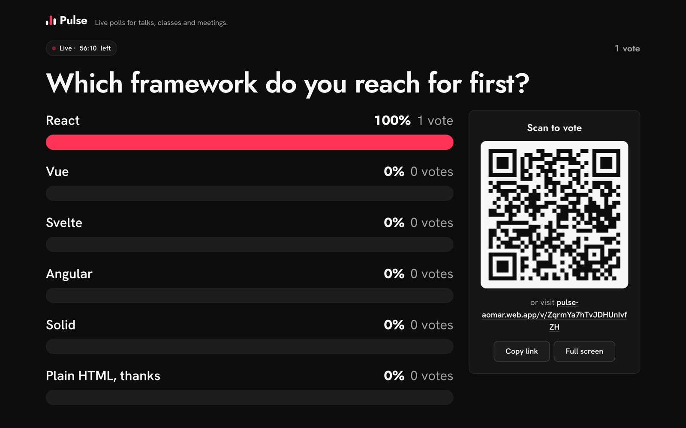

# Pulse: live polls

Real-time audience polls for talks, classes and meetings, in the spirit of Slido or Mentimeter but small enough to read in one sitting.

A presenter writes a question, puts the presenter view on a projector, and the audience scans a QR code to vote from their phones. Bars animate as votes arrive, with no accounts, no app install and no backend server: just a static React app talking to Cloud Firestore.

**Live demo:** [pulse-aomar.web.app](https://pulse-aomar.web.app)

## Why it is interesting technically

- **Real time with no server.** The presenter and audience views subscribe to the poll's `votes` subcollection with `onSnapshot`, so every screen updates within a moment of a tap.
- **Security rules do the backend's job.** With no Cloud Functions on the free plan, `firestore.rules` is the API contract. It allows only the exact document shapes the app writes: allowed keys, types, string lengths, a 2 to 6 option list, `createdAt == request.time`, a closing time within 24 hours of the server clock, and a vote option index checked against the parent poll with `get()`. Votes after the closing time are rejected on the server, not just hidden in the UI.
- **One vote per device without sign-in.** Each device gets a random anonymous id stored in `localStorage`, and the vote document id *is* that id. A second vote from the same device would be an update, which the rules deny, so duplicate prevention needs no extra reads or transactions.
- **Honest optimistic UI.** Firestore shows a pending write in the local snapshot straight away. The ballot waits for the server to accept the vote before saying thanks, so a rejected vote (for example, one cast a second after the poll closed) never shows a false confirmation.
- **Small, split bundle.** No router or UI library. Voters never download the presenter view or the QR encoder, and Firebase and React sit in separate long-cached vendor chunks.
- **QR codes rendered locally** with the `qrcode` package as SVG, so poll links never go to a third-party QR service.

## Features

- Create a poll: question (up to 140 characters), 2 to 6 options (up to 60 characters each, no duplicates), open for 15 minutes, 1 hour or 24 hours.
- "Try a demo poll" creates a sample poll in one click.
- Presenter view (`/p/{pollId}`): large question, live animated bars with counts and percentages, total votes, a countdown, a large QR code, the short join URL, Copy link and Full screen. The leading option is highlighted.
- Audience view (`/v/{pollId}`): mobile-first, large tap targets, one vote per device, then a thank-you with live results and "Your vote" marked.
- Clear states for loading, poll not found, poll closed, offline, rejected votes and a missing Firebase configuration.
- Keyboard and screen reader friendly: semantic HTML, labelled controls, visible focus rings, skip link, and motion only when the system allows it.

## Stack

- React 19 and TypeScript (strict), built with Vite 8
- Cloud Firestore through the Firebase JS SDK v12 (modular API)
- Firebase Hosting on the free Spark plan
- `qrcode` for local SVG QR codes
- Plain CSS with design tokens; Jost and Hanken Grotesk via Fontsource

## Project structure

```
src/
  components/   UI pieces (form, results bars, join panel, status states)
  hooks/        data and browser hooks (poll, live votes, countdown, fullscreen, clipboard)
  lib/          Firestore access, validation, tallying, routing, formatting
  pages/        Home, Presenter, Audience, Not found
  styles/       global.css
firestore.rules         the server-side contract
firestore.indexes.json  no composite indexes needed
firebase.json           hosting (SPA rewrite, asset caching) and Firestore config
```

## Run locally

Requirements: Node.js 20.19 or later (Vite 8), and a Firebase project with Cloud Firestore enabled.

```bash
npm install
cp .env.example .env.local   # then fill in your Firebase web app settings
npm run dev
```

Without `.env.local` the app still starts and shows a "not configured" message instead of crashing.

Other scripts:

```bash
npm run typecheck   # TypeScript, no emit
npm run build       # typecheck and production build into dist/
npm run preview     # serve the production build locally
```

To try the audience view on a phone during development, run `npm run dev -- --host` and open the network URL the dev server prints.

## Deployment

Pulse is deployed to **Firebase Hosting on the free Spark plan**, with Firestore as the only backend service. No Cloud Functions, Storage or Auth are used, so it costs nothing to run at demo scale.

```bash
npm run build
firebase use --add                       # pick your project
firebase target:apply hosting pulse <your-site-id>
firebase deploy --only firestore:rules,firestore:indexes,hosting:pulse
```

`firebase.json` rewrites every path to `index.html` (client-side routing), caches hashed files under `/assets/` for a year and serves `index.html` and every app route (`/`, `/p/…`, `/v/…`) with `no-cache`, so a browser never holds HTML that points at chunks a newer deploy removed. If a chunk still fails to load, for example on flaky venue Wi-Fi, an error boundary offers a reload instead of a blank page.

## Design decisions and limits

- **Counting on the client.** Each view listens to the whole `votes` subcollection and counts in the browser. That is simple and fine for a room of a few hundred people. In production I would keep running totals with sharded counters or aggregate them in a Cloud Function, which would also mean views read a few documents instead of every vote. That was left out to stay on the free plan.
- **Anonymous voting.** One vote per device is enforced, not one vote per person: a private window or a cleared browser gets a new id. That is the usual trade-off for sign-up-free polls.
- **Open poll creation.** Anyone can create a poll. The rules bound every field, but adding Firebase App Check would be the next step against automated abuse.
- **Device clocks.** The closing time is set on the creator's device and checked against the server clock, so a device clock that is wildly wrong can cause a creation to be rejected. The 24-hour option ends two minutes early to absorb normal clock drift.
- **Votes are public.** Vote documents hold only an option index, a timestamp and a random id, so the results can be read by anyone with the link.

## Screenshots



---

Built by [Abdullah Omar](https://abdullah-omar-portfolio.netlify.app/).
